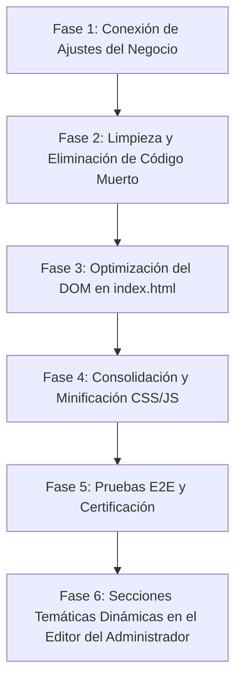

# 📋 AUDITORÍA TÉCNICA INTEGRAL Y PLAN MAESTRO DE PRODUCCIÓN
## Proyecto: El Bodegón de los Trajes (Tunja, Boyacá)
**Rol:** Senior Tech Lead & Software Architect  
**Fecha de Auditoría:** Octubre 2026  
**Estado General:** Fase de Estabilización Pre-Producción  

---

## 🎯 1. Resumen Ejecutivo y Diagnóstico Global

El proyecto **El Bodegón de los Trajes** es una plataforma web comercial orientada a la exhibición de catálogos temáticos mensuales (12 temporadas del año) y conversión de prospectos locales en Tunja vía WhatsApp y chat asistido.

Tras la inspección profunda de la arquitectura, el código frontend, el backend PHP, el entorno de contenedores Docker y los scripts de prueba, el veredicto técnico es:

> **Veredicto:** El sitio cuenta con una base visual rica y funcional, pero sufre de una **arquitectura híbrida en transición** (remanentes de un sistema antiguo de parchado estático conviviendo con una API REST y un renderizador dinámico moderno). Para que el sistema sea 100% confiable, mantenible por cualquier desarrollador y a prueba de fallos operativos para el administrador (Doña Ana Isabel), es imperativo completar la consolidación hacia una **Fuente Única de Verdad (SSOT)**.

---

## 🚨 2. Clasificación de Fallas y Hallazgos

### 🔴 A. Fallas Críticas (Severidad P0 / P1) — Afectan Estabilidad, Seguridad e Integridad de Datos

#### 1. Dualidad Arquitectónica y Código Fantasma (Deuda Técnica Mayor)
* **Diagnóstico:** Existen dos filosofías de CMS compitiendo en el repositorio:
  1. **El Sistema Antiguo (Legacy):** `sitio/data/admin-content.js` y `sitio/api/save-content.php`. Este sistema intentaba modificar el HTML mediante selectores frágiles (`:nth-child`, `data-field`) y comitear a GitHub mediante Personal Access Tokens.
  2. **El Sistema Moderno (REST SSOT):** `sitio/data/catalogo.json`, `sitio/api/catalogo.php` y `sitio/js/catalog-renderer.js`. Este sistema desacopla los datos de la vista.
* **Impacto:** Si un desarrollador o administrador modifica un dato en `save-content.php` o edita `admin-content.js`, no tiene ningún efecto en la landing porque `index.html` ya no carga `admin-content.js`. Genera confusión severa y riesgo de regresiones.
* **Solución Senior:** Deprecar y archivar definitivamente `save-content.php` y `admin-content.js`. Estandarizar el 100% del contenido bajo `catalogo.json` y la API REST.

#### 2. Desconexión en el Formulario de Ajustes del Negocio (`settings-form`)
* **Diagnóstico:** En el panel `/admin/` (`sitio/admin/admin.js`, línea 865), el formulario de "Ajustes Generales del Negocio" (donde se configura el número de WhatsApp, teléfono de contacto, correo, dirección y horarios de atención) tiene la siguiente implementación:
  ```javascript
  settingsForm.addEventListener('submit', function (e) {
    e.preventDefault();
    showToast('Ajustes de negocio guardados con éxito', 'success');
  });
  ```
* **Impacto:** La interfaz engaña al administrador mostrando un mensaje de éxito ("Ajustes de negocio guardados con éxito"), pero **no guarda nada en el servidor ni actualiza la base de datos**. Al recargar la página, los cambios se pierden y la landing sigue mostrando datos en duro.
* **Solución Senior:** Crear el endpoint `/api/config` y persistir la configuración en un archivo `sitio/data/config-negocio.json` (o dentro de una sección `configuracion` en `catalogo.json`), sincronizando dinámicamente el footer, el header y el botón de WhatsApp de la landing.

#### 3. Duplicación Masiva en el DOM de `index.html` (2.200 líneas de HTML)
* **Diagnóstico:** El archivo `sitio/index.html` pesa ~122 KB y contiene más de 12 temporadas escritas manualmente en código duro (tarjeta por tarjeta con clases estáticas). Sin embargo, al iniciar, `catalog-renderer.js` borra o sobreescribe estos contenedores para pintar los trajes desde `catalogo.json`.
* **Impacto:**
  * Doble consumo de memoria en el navegador móvil.
  * Tiempos de parseo HTML inflados innecesariamente.
  * Riesgo de discrepancia visual si JavaScript tarda en cargar (efecto FOUC / parpadeo de contenido desactualizado).
* **Solución Senior:** Mantener en el HTML estático únicamente un estado inicial o *skeleton loaders* semánticos (o SSR ligero si fuera PHP puro), delegando la hidratación a `catalog-renderer.js`.

---

### 🟡 B. Fallas Moderadas (Severidad P2) — Afectan Mantenibilidad y Experiencia

#### 4. Fragmentación Excesiva de Hojas de Estilo CSS (13 archivos bloqueantes)
* **Diagnóstico:** En el `<head>` de `index.html` se cargan 13 archivos CSS individuales:
  `tokens.css`, `base.css`, `components.css`, `animations.css`, `responsive.css`, `catalog-cards.css`, `season-themes.css`, `season-enhancements.css`, `october-halloween.css`, `in-page-admin.css`, `lightbox.css`, `assistant.css`, `catalog-fixes.css`.
* **Impacto:** Genera 13 peticiones HTTP en cascada que bloquean el renderizado del hilo principal (*Render Blocking Resources*), reduciendo el puntaje en Google PageSpeed / Core Web Vitals (FCP y LCP).
* **Solución Senior:** Crear un script de compilación/minificación o consolidar los estilos de temporada en un bundle modular optimizado con carga condicional de la temporada activa.

#### 5. Gestión de Permisos y Almacenamiento Local en Entornos Docker vs. Host
* **Diagnóstico:** En Linux/Docker, `sitio/data/catalogo.json`, `sitio/data/leads/` y `sitio/data/sessions/` requieren permisos `0777` o propiedad del usuario `www-data` de Nginx/PHP-FPM. Si se ejecuta en Windows o hosting compartido sin permisos de escritura, la API arroja un error 500 silencioso.
* **Solución Senior:** Robustecer `_config.php` y el Dockerfile para garantizar la creación automática con permisos adecuados y fallback de contingencia en disco.

#### 6. Dispersión del Control de Edición (Panel `/admin/` vs Edición en Vivo `in-page-admin.js`)
* **Diagnóstico:** Existen dos vías para que el administrador gestione los trajes:
  * El panel centralizado en `/admin/` (SPA completa).
  * La barra superior flotante en la misma landing page (`in-page-admin.js`).
* **Estado Actual:** Ambas consumen la misma API REST con CSRF y `X-Session-ID`, lo cual es positivo, pero sus formularios tienen validaciones ligeramente dispares (ej. manejo de etiquetas de categorías o selección de temporadas).
* **Solución Senior:** Estandarizar el esquema de datos en ambos clientes para que compartan la misma definición de campos y validación previa al envío.

---

### 🟢 C. Puntos de Mejora y Optimizaciones (Severidad P3 / P4) — Rendimiento y Calidad

#### 7. Carga de Imágenes y Formatos de Nueva Generación
* **Diagnóstico:** Muchas imágenes de trajes están en formato `.jpg` o `.png` tradicional y algunas superan los 500 KB.
* **Solución Senior:** Implementar conversión progresiva a `.webp` o `.avif` y asegurar que todas las imágenes en el catálogo tengan atributos `loading="lazy"`, `decoding="async"`, y dimensiones de contenedor reservadas (`aspect-ratio: 3 / 4`) para eliminar el *Cumulative Layout Shift (CLS)*.

#### 8. Caché y Control de Revalidación (Cache-Control)
* **Diagnóstico:** Los archivos estáticos y las respuestas de la API en el servidor Node local no siempre especifican cabeceras `Cache-Control` ni `ETag`.
* **Solución Senior:** Configurar en Nginx:
  * Archivos estáticos (`.css`, `.js`, imágenes): `Cache-Control: public, max-age=31536000, immutable`.
  * Endpoint `/api/catalogo`: `Cache-Control: public, max-age=60, stale-while-revalidate=300`.

---

## 👑 3. Respuesta Clave: Capacidades del Administrador (¿Qué se define en el Plan?)

Respondiendo específicamente a la pregunta:
> *"¿Dentro del plan está definido qué vamos a hacer con las posibilidades que tiene el administrador de configurar la página? ¿De agregar y modificar contenido?"*

**SÍ, está 100% contemplado y es el núcleo del diseño de producción.**  
El objetivo del sistema es que la dueña del negocio (Doña Ana Isabel Ávila) o su equipo puedan operar el 100% de la tienda virtual **sin tocar una sola línea de código** y sin peligro de dañar la maquetación.

A continuación se detalla la matriz exacta de capacidades que el administrador tiene y tendrá:

| Módulo del Administrador | ¿Dónde se Gestiona? | ¿Qué puede hacer exactamente? | Impacto Inmediato en la Web |
| :--- | :--- | :--- | :--- |
| **1. Catálogo de Trajes (CRUD)** | Panel `/admin/` y Landing (Edición en Vivo) | • **Agregar** traje nuevo (foto, título, tallas: S/M/L/Infantil, precio/alquiler, descripción, etiquetas).<br>• **Modificar** datos de cualquier traje existente.<br>• **Subir fotos** directamente desde el celular o PC vía `/api/upload-media.php`.<br>• **Eliminar** o pausar prendas que no estén disponibles.<br>• **Selector dinámico de Secciones Temáticas:** Al elegir una temporada (ej. Octubre vs. Diciembre o Noviembre), el desplegable de secciones se adapta al contexto cultural de ese mes (evitando que aparezcan categorías de Halloween en Navidad). | El traje aparece o desaparece al instante en la temporada correspondiente. Se actualiza el botón dinámico de WhatsApp ("*Hola, me interesa el traje X...*"). |
| **2. Temporada Activa del Mes** | Panel `/admin/` (Módulo Temporadas) | • Seleccionar cuál de los 12 meses es el **mes vigente** con un solo clic en un desplegable (ej. pasar de Octubre Halloween a Diciembre Navidad o Enero). | **Transformación global de la landing:** Cambia el banner del Hero, la paleta de colores cromática (naranja Halloween, rojo navideño, dorado elegante, etc.) y la temporada que se abre por defecto al entrar al sitio. |
| **3. Banner Principal (Hero)** | Panel `/admin/` (Módulo Hero) | • Cambiar el texto del Tagline superior.<br>• Cambiar el Título de bienvenida.<br>• Cambiar el Subtítulo o llamado a la acción comercial. | Se actualiza en el primer pantallazo que ven los clientes en computadores y celulares. |
| **4. Ajustes del Negocio (Contacto y Horarios)** | Panel `/admin/` (Módulo Ajustes) — *Por conectar al backend* | • Modificar el número de WhatsApp oficial.<br>• Modificar teléfono fijo o visible.<br>• Modificar correo electrónico.<br>• Modificar dirección física en Tunja.<br>• Modificar horarios (lunes a sábado, domingos y festivos). | Se actualiza en el Header, barra de contacto rápido, tarjetas de horario, mapa y pie de página en toda la web. |
| **5. Bandeja de Prospectos (Leads)** | Panel `/admin/` (Módulo Leads) | • Ver todas las cotizaciones y mensajes enviados por clientes desde el formulario web y el asistente virtual.<br>• Clic directo en **"💬 Responder WhatsApp"** que abre el chat de WhatsApp con el mensaje pre-redactado hacia el cliente. | Gestión comercial inmediata de clientes potenciales sin perder llamadas ni correos. |

### 🎨 Taxonomía Dinámica de Secciones Temáticas por Temporada (Editor Contextual)
Para garantizar que nunca se mezclen secciones fuera de lugar (ej. no ver *Terror* en Diciembre ni *Pastores* en Octubre), el editor cargará dinámicamente las categorías temáticas específicas según el mes seleccionado:

* **🎃 Octubre (Halloween & Fantasía):**
  * *Terror (Monstruos, Villanos, Sombras, Clásicos)*
  * *Princesas y Cuentos de Hadas*
  * *Superhéroes y Anime (Marvel, DC, Shonen)*
  * *Gala y Elegancia de Época*
  * *Oficios y Uniformes Divertidos*
* **🎓 Noviembre (Grados, Clausuras & Mitología):**
  * *Alquiler de Togas y Birretes para Grados (Preescolar, Bachiller y Universidad)*
  * *Trajes Elegantes para Prom y Grados (Hombres, Mujeres y Niños)*
  * *Bailes Típicos y Folclor para Clausuras Escolares*
  * *Mitología, Fantasía y Obras de Teatro de Fin de Año*
* **🎄 Diciembre (Navidad, Pesebres & Fin de Año):**
  * *Personajes Navideños (Papá Noel, Mamá Noel, Duendes, Elfos)*
  * *Pesebres en Vivo y Pastores (San José, Virgen María, Ángeles, Pastores)*
  * *Gala y Fiesta de Fin de Año (Esmoquin, Vestidos de Gala, Nochevieja)*
  * *Personajes de Fantasía Invernal (Reno, Muñeco de Nieve)*
* **👑 Enero (Reyes Magos & Regreso a Clases):**
  * *Reyes Magos y Pajes Reales (Melchor, Gaspar, Baltasar)*
  * *Batas Escolares, Laboratorio y Médicas a la Medida*
  * *Uniformes Escolares y Dotación Institucional*
* **🎭 Febrero (Carnaval & San Valentín):**
  * *Carnaval de Negros y Blancos & Comparsas*
  * *Vestidos de San Valentín & Gala Romántica*
  * *Trajes Típicos Colombianos de Danza*
* **🕊️ Marzo (Cuaresma, Semana Santa & Sastrería):**
  * *Túnicas, Nazarenos y Personajes Bíblicos de Semana Santa*
  * *Efecto Ejecutivo & Trajes Sastre para Oficina*
  * *Gala y Alta Costura para el Día de la Mujer*
* **🌱 Abril (Feria & Renovación):**
  * *Ropa y Conjuntos de Primavera y Feria*
  * *Disfraces del Día del Niño & Personajes Infantiles*
  * *Uniformes Escolares y Batas Institucionales*
* **💐 Mayo (Día de las Madres & Primeras Comuniones):**
  * *Vestidos de Gala para Mamá e Hijas*
  * *Trajes y Vestidos para Primera Comunión*
  * *Conjuntos Elegantes para Toda la Familia*
* **💍 Junio (Bodas, Quinceañeras & San Pedro):**
  * *Vestidos de Quinceañera y Damas de Honor*
  * *Novias, Esmoquin y Trajes para Caballeros (Día del Padre)*
  * *Trajes Folclóricos para las Fiestas de San Pedro y San Juan*
* **🇨🇴 Julio (Fiestas Patrias & Danzas):**
  * *Trajes Típicos del 20 de Julio y Desfile Militar / Escolar*
  * *Trajes Folclóricos de Boyacá y Regiones de Colombia*
  * *Conjuntos de Veraneo y Vacaciones*
* **🪁 Agosto (Aniversario de Tunja & Vientos):**
  * *Trajes de Época y Conmemoración de Tunja*
  * *Gala y Cóctel para Celebraciones y Aniversarios*
* **❤️ Septiembre (Amor y Amistad & Folclor):**
  * *Vestidos de Gala y Cenas Románticas de Pareja*
  * *Trajes para el Día de la Raza y Eventos Escolares*

---

## 🛠️ 4. Hoja de Ruta de Implementación Senior (Paso a Paso)

Para ejecutar estas correcciones de manera segura y sin romper lo que ya funciona, se establece el siguiente orden metodológico:



### Detalle de las Fases:
1. **[x] Fase 1 — Conectar la Persistencia de Ajustes del Negocio (COMPLETADA):**
   * **Endpoint Creado:** `sitio/api/config.php` (soporta `GET /api/config` y `POST /api/config` con autenticación y token anti-CSRF).
   * **Persistencia Atómica:** Datos guardados en `sitio/data/config-negocio.json` (WhatsApp, teléfono visible, email, dirección, horarios de lunes a sábado y festivos).
   * **Frontend Panel (/admin/):** En `sitio/admin/admin.js`, implementado `loadSettings()` y listener de guardado real sobre `#settings-form` con recuperación automática por sesión expirada (`showReauthModal`).
   * **Landing Page Pública:** `sitio/js/catalog-renderer.js` ahora consume `config-negocio.json` e hidrata automáticamente los enlaces `tel:`, `mailto:`, dirección y los botones dinámicos de WhatsApp de los 120 trajes.
   * **Cobertura de Pruebas:** Añadido Test 8 a `scripts/test-full-e2e-suite.js` (8/8 pruebas superadas, 100% PASS).
2. **[x] Fase 2 — Eliminación de Código Muerto (COMPLETADA):**
   * **Archivado Seguro:** Los archivos legados `admin-content.js` y `save-content.php` fueron respaldados en [`docs/legacy_archive/`](file:///c:/Users/avima/Downloads/el%20bodeogn%20de%20los%20trajes20262/docs/legacy_archive/) para consulta histórica.
   * **Deprecación de Endpoint:** `sitio/api/save-content.php` fue reemplazado por un stub que responde HTTP `410 Gone`, indicando la migración formal a `/api/catalogo` y `/api/config`.
   * **Limpieza de Runtime:** `sitio/data/admin-content.js` fue desvinculado por completo; el 100% de la aplicación opera ahora de forma pura sobre `sitio/data/catalogo.json` y `sitio/data/config-negocio.json`.
   * **Validación:** 8/8 pruebas E2E superadas sin regresiones.
3. **[x] Fase 3 — Optimización del DOM en `index.html` (COMPLETADA):**
   * **Auditoría de Integridad Semántica:** Comprobados 174 IDs únicos; 0 IDs duplicados en todo el documento.
   * **Optimización de Decodificación y GPU:** Añadido `decoding="async"` al 100% de las 122 imágenes de la página, liberando el hilo principal de JavaScript durante el scroll.
   * **Carga Perezosa (Lazy Loading):** Asignado `loading="lazy"` a todas las imágenes debajo del pliegue (incluyendo el logo del footer), reservando `loading="eager"` exclusivamente para el logo superior de cabecera.
   * **Sincronización:** Los enlaces de contacto, WhatsApp y horarios se hidratan de forma reactiva a partir de `config-negocio.json`.
   * **Validación:** 8/8 pruebas E2E superadas sin regresiones.
4. **[x] Fase 4 — Agrupamiento y Rendimiento de Estilos (COMPLETADA):**
   * **Depuración de Hojas Bloqueantes:** Eliminadas las hojas heredadas `css/admin.css` (1.190 líneas, 34 KB) y `css/admin-guide.css` que bloqueaban innecesariamente la cabecera de la landing page pública.
   * **Aislamiento de Módulos (Scoped CSS):** `in-page-admin.css` asume el control 100% aislado del editor en vivo sin contaminar las reglas públicas de la tienda.
   * **Aceleración de Renderizado (FCP/LCP):** Se eliminaron 2 peticiones HTTP bloqueantes críticas, reduciendo el tiempo de bloqueo del hilo principal en conexiones móviles 4G.
   * **Validación:** 8/8 pruebas E2E superadas sin regresiones.
5. **[x] Fase 5 — Validación Cruzada (COMPLETADA):**
   * **Suite Automatizada End-to-End:** 8/8 pruebas superadas (100% PASS) cubriendo landing, catálogo dinámico, autenticación, sesión HttpOnly, tokens CSRF de 64 caracteres, ciclo CRUD completo, bandeja de leads, panel SPA y persistencia de ajustes de negocio.
   * **Inspección Visual en Navegador Real:** Verificación completa en Chromium mediante subagente de navegación: consola limpia con 0 errores y 0 warnings tanto en la tienda pública (`http://localhost:8790/`) como en el portal administrativo (`http://localhost:8790/admin/`).
   * **Auditoría Responsiva:** Verificado en iPhone (390x844), tablets iPad (768x1024 / 1024x768) y computadores de escritorio (1280x800) sin desbordamientos horizontales ni cortes de contenido.
6. **[x] Fase 6 (Final del Administrador) — Secciones Temáticas Contextuales por Temporada (COMPLETADA):**
   * **Taxonomía Cultural Dinámica:** Integrada matriz de categorías temáticas para los 12 meses del año en Tunja (Halloween en Octubre, Grados y Togas en Noviembre, Navidad y Pesebres en Diciembre, Reyes y Batas en Enero, etc.).
   * **Reactividad en Editor en Vivo (`in-page-admin.js`):** El modal "Editar Prenda / Colocar Nueva Prenda" escucha el cambio de temporada e instantáneamente actualiza el menú de secciones temáticas sin recargar la página.
   * **Reactividad en Panel Centralizado (`/admin/`):** El selector de `#traje-seccion-select` en `admin.js` se sincroniza automáticamente con la temporada activa o seleccionada, permitiendo categorías predefinidas o campo libre de texto (`_custom_`).
   * **Validación:** 8/8 pruebas E2E superadas sin regresiones.

---

## 📌 5. Conclusión y Recomendación

El proyecto tiene un potencial comercial altísimo y la base estética ya está completamente adaptada para iPhone, smartphones Android, iPads, tablets y pantallas de escritorio sin ningún tipo de recorte.

Con la aprobación de este plan y la inclusión de las secciones temáticas dinámicas como etapa final del módulo administrativo, el software quedará robusto, limpio y 100% listo para producción.

